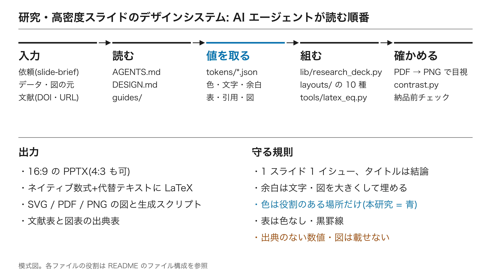
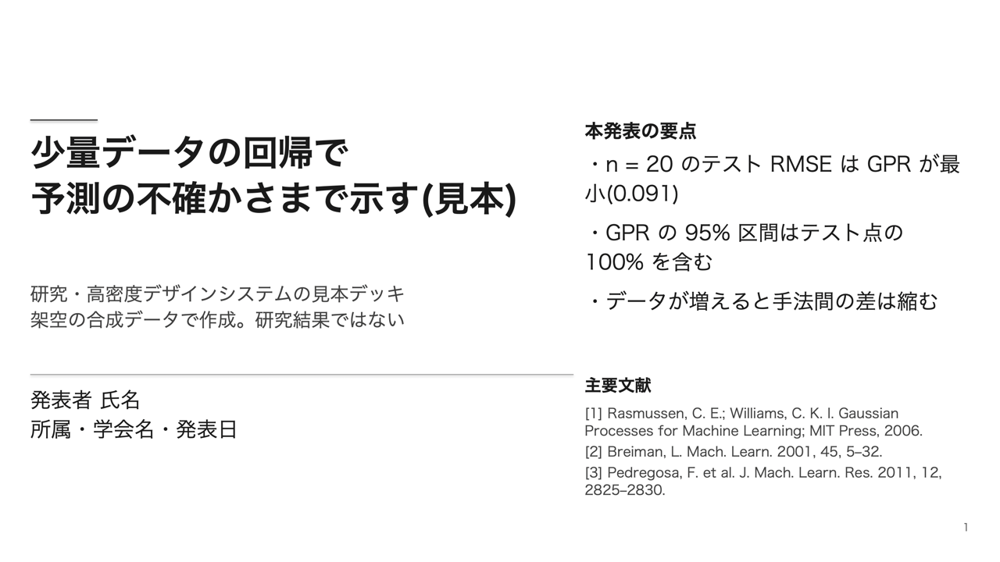
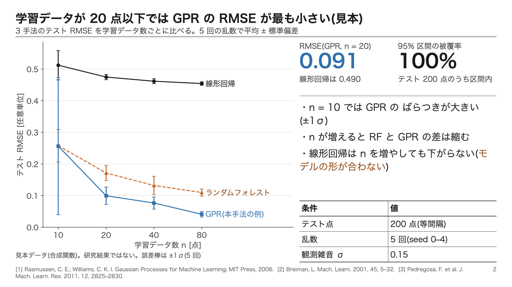
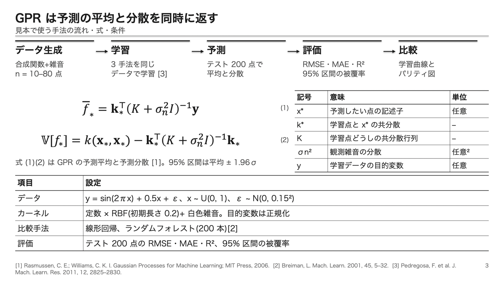
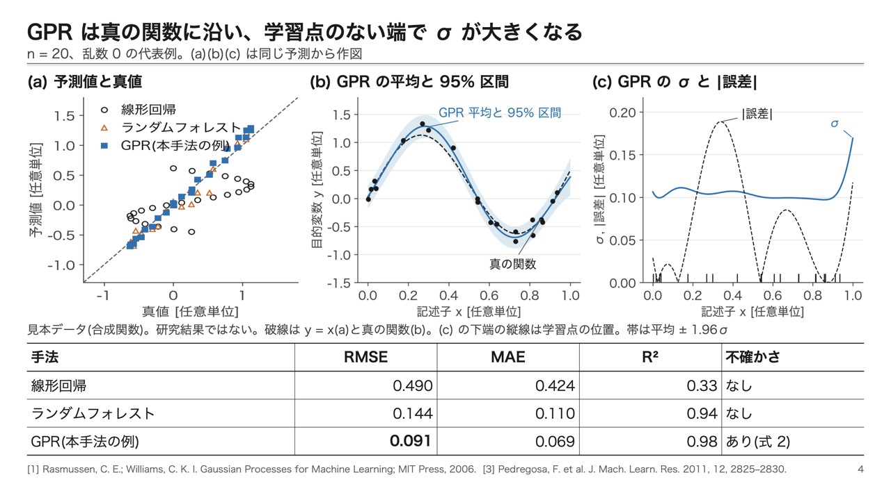
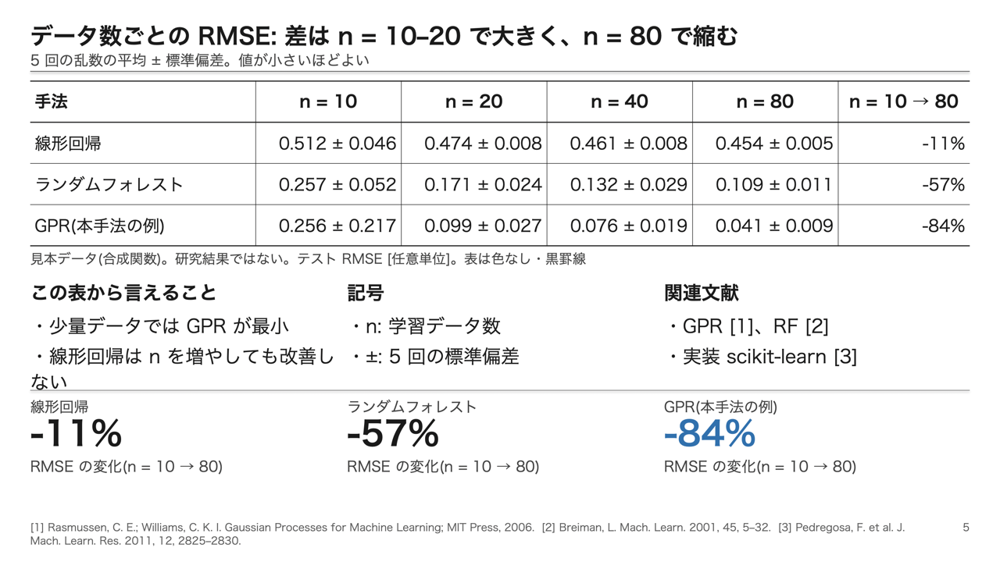
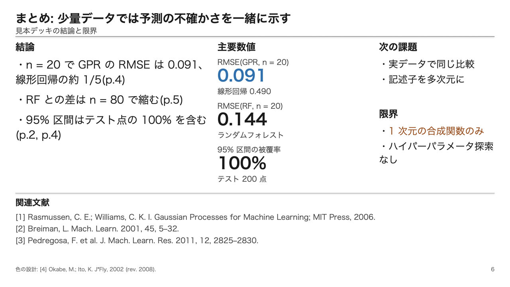
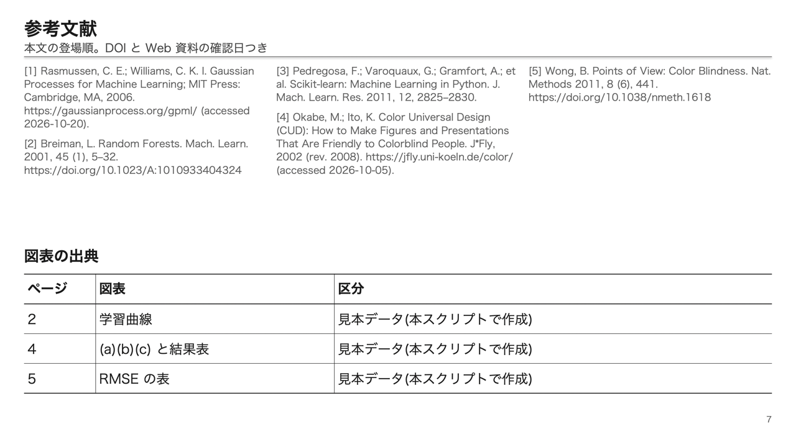
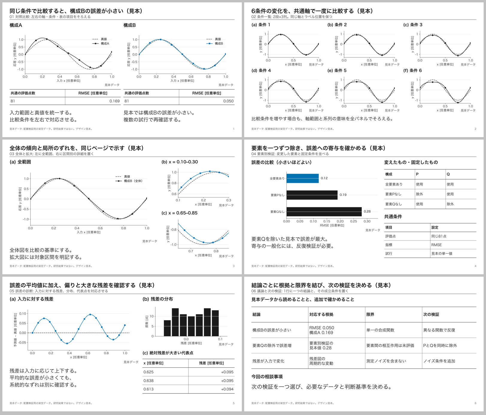

# research-slide-design

学会発表・研究紹介・進捗報告のための、**白黒基調・高密度**のスライド用デザインシステム。
Claude Code / Codex などの AI エージェントがそのまま読める形(DESIGN.md + tokens + layouts + guides + lib + examples)にしてあり、仕様を読ませるだけで同じ見た目のスライドを作れる。



## 特徴

- **高密度・1スライド1イシュー**: 主張を支える図・表・要点数値・注を 12 カラムのグリッドに詰める。余白が残ったら、まず文字と図を大きくする。
- **16:9 が標準**(4:3 も同じ規則で使える)。ヒラギノ角ゴ ProN W3/W6、本文 16pt 以上。
- **バリアフリーな色**: 白黒+役割を決めた色だけ(本研究 = Blue、注意 = 暗い Vermillion)。文字は 4.5:1 以上、主要な文字は 7:1 以上。色だけで区別しない。`tools/contrast.py` で検査。
- **表は色なし・黒罫線**。
- **数式は LaTeX が正本**: PowerPoint のネイティブ数式に変換し、元の LaTeX を代替テキストに残す。変換環境がなくても `$$ … $$` で置いて、後でまとめて変換できる。
- **図は決まったフロー**で作る(構成を文字で決める → SVG で描く → 書き出して目視 → 文字の大きさを検査)。
- **出典を必ず書く**: 本文 [n]、ページ下端の短縮出典、最終ページの文献表(ACS 風)。

## 見本

`examples/build_sample.py` が架空の合成データから作る 7 枚(16:9)。数値はすべてスクリプトの計算結果。

| | |
| --- | --- |
|  |  |
|  |  |
|  |  |
|  | |

PDF: [examples/out/sample_16x9.pdf](examples/out/sample_16x9.pdf)

### 追加レイアウト6種（16:9）

同じ規定のまま、比較・検証・考察に使える構成を追加。基本10種との選び分けは [ガイド](guides/layout-selection.md)。



[PDF](examples/out/layout_gallery/layout_gallery_16x9.pdf) / [編集できるPowerPoint](examples/out/layout_gallery/layout_gallery_16x9.pptx) / [生成スクリプト](examples/build_layout_gallery.py)

数値はすべて見本データ。対照比較・残差図は合成関数から計算し、要素別検証の値は配置確認用に設定した定数。研究結果ではない。

## ファイル構成

```
research-slide-design/
├── README.md                  このファイル
├── AGENTS.md / CLAUDE.md      AI エージェントの入口(作業の順番と守ること)
├── DESIGN.md                  仕様の本体(版面・文字・色・図・表・数式・引用・納品前チェック)
├── REFERENCES.md              設計の根拠となった文献(DADS、Okabe & Ito、WCAG など)
├── CHANGELOG.md / LICENSE
├── tokens/                    値の正本(JSON)
│   ├── colors.json            色と役割(roles)、系列色・マーカー・線種
│   ├── typography.json        書体(PowerPoint 用のウェイト名)、文字サイズの標準と上限
│   ├── spacing-16x9.json      16:9 の版面・12 カラム・余白の埋め方(標準)
│   ├── spacing.json           4:3 の版面
│   ├── tables.json            色なし・黒罫線の表
│   ├── charts.json            グラフの様式
│   └── citation.json          引用・出典欄・文献表の書式(ACS 風)
├── layouts/                   16 種のページ構成(追加6種は16:9専用)+対応表
│   ├── cover.md  figure-notes.md  two-figures.md  figure-table.md  dense-table.md
│   ├── method.md  equation.md  key-numbers.md  summary.md  references.md
│   ├── matched-comparison.md  small-multiples-6.md  overview-detail.md
│   ├── ablation.md  error-diagnosis.md  evidence-next.md
│   └── 16x9.md
├── guides/                    使い方の手引き
│   ├── layout-selection.md    基本10種と追加6種の選び分け
│   ├── use-cases.md           学会発表・研究紹介・進捗報告の組み方、ユーザビリティ
│   ├── figures.md             図の作成フロー(模式図 SVG / matplotlib)
│   ├── equations.md           LaTeX の書き方・変換・取り出し
│   └── slide-brief.md         AI エージェントへの依頼書式(YAML)
├── lib/
│   ├── research_deck.py       python-pptx のビルダー(Deck / Slide、表・式・出典欄)
│   └── research.mplstyle      matplotlib の様式
├── tools/
│   ├── latex_eq.py            LaTeX → PowerPoint ネイティブ数式(--convert / --extract)
│   └── contrast.py            色のコントラスト比の検査(WCAG 2.x)
├── examples/
│   ├── build_layout_gallery.py  追加レイアウト6種の見本(16:9)
│   ├── build_sample.py        見本デッキ(16:9、7 枚)を作る
│   ├── overview_figure.py     模式図(SVG)の見本。docs/ の図を作る
│   └── out/                   sample_16x9.pptx / .pdf
├── docs/                      README の図(overview / figure-flow)と見本の画像
├── skills/research-slide-design/  Claude Code / Codex 用スキル
└── scripts/
    ├── pptx2pdf.sh            PowerPoint で PDF に書き出す(macOS)
    ├── pdf2png.swift          PDF の全ページを PNG に(macOS)
    ├── export_svg.sh          SVG → PDF / PNG、最小文字サイズの検査(Inkscape)
    └── install_skill.sh       スキルを ~/.claude/skills と ~/.codex/skills にリンク
```

## 使い方

```bash
# 見本デッキを作る(依存は uv が一時的に用意する)
uv run --no-project --with python-pptx --with lxml --with latex2mathml \
  --with matplotlib --with numpy --with scikit-learn python examples/build_sample.py

# 追加レイアウト6種の見本を作る
uv run --no-project --with python-pptx --with lxml --with matplotlib --with numpy \
  python examples/build_layout_gallery.py

# 追加見本を PDF 化する(macOS + PowerPoint)
scripts/pptx2pdf.sh examples/out/layout_gallery/layout_gallery_16x9.pptx examples/out/layout_gallery/layout_gallery_16x9.pdf

# PDF と PNG にして目視する(macOS + PowerPoint)
scripts/pptx2pdf.sh examples/out/sample_16x9.pptx examples/out/sample_16x9.pdf
swift scripts/pdf2png.swift examples/out/sample_16x9.pdf examples/out/png

# 色のコントラストを検査する
python3 tools/contrast.py

# 模式図を描いて書き出す(Inkscape)
python3 examples/overview_figure.py && scripts/export_svg.sh docs/overview.svg

# AI エージェント用スキルをリンクする
scripts/install_skill.sh
```

Python からは次のように組む(詳しくは `lib/research_deck.py` の冒頭と見本)。

```python
import sys; sys.path.insert(0, "lib")
from research_deck import Deck
deck = Deck("16:9")
s = deck.slide("結論を 1 文で書いたタイトル", "何を比べた図か")
x, w = s.col(0, 7)                       # 12 カラムのうち 0 番から 7 本
s.image("fig.png", x, s.top, w, credit="本研究(未発表)")
x, w = s.col(7, 5)
s.number(x, s.top, w, "RMSE(提案法)", "0.091", "従来法 0.490", accent=True, size=36)
s.equation(r"\bar{f}_{*} = \mathbf{k}_{*}^{\top}\left(K + \sigma_{n}^{2} I\right)^{-1}\mathbf{y}", x, 3.0, w, 0.8, number=1)
s.sources(["[1] Rasmussen, C. E.; Williams, C. K. I. Gaussian Processes for Machine Learning; MIT Press, 2006."])
deck.save("deck.pptx")
```

### AI エージェントに使わせる

1. このリポジトリを作業フォルダに置くか、`scripts/install_skill.sh` でスキルをリンクする。
2. 「研究・高密度デザインで、このデータから 12 分の学会発表スライドを作って」のように頼む。エージェントは `AGENTS.md` → `DESIGN.md` → `guides/slide-brief.md` の書式で中身を整理し、足りない出典・数値を質問してから作る。
3. 仕上げに PDF → PNG で全ページを目視し、`DESIGN.md` の「納品前チェック」を満たしたものを渡す。

必要なもの: Python 3.10+(python-pptx, lxml, latex2mathml, matplotlib)、[uv](https://docs.astral.sh/uv/)(任意)、Microsoft PowerPoint(PDF 化と目視)、Microsoft Word(数式のネイティブ変換。ない場合は LaTeX のプレースホルダーになる)、Inkscape(SVG の書き出し)。フォントはヒラギノ角ゴ ProN(macOS 標準)。Windows では游ゴシックなどに置き換わるので、配布は PDF で行う。

## 参考文献

設計の根拠(詳細と確認日は [REFERENCES.md](REFERENCES.md))。

1. デジタル庁. デジタル庁デザインシステム: カラー. https://design.digital.go.jp/dads/foundations/color/ (accessed 2026-10-05).
2. デジタル庁. デジタル庁デザインシステム: カラー/アクセシビリティ. https://design.digital.go.jp/dads/foundations/color/accessibility/ (accessed 2026-10-05).
3. Okabe, M.; Ito, K. Color Universal Design (CUD): How to Make Figures and Presentations That Are Friendly to Colorblind People. J*Fly, 2002 (rev. 2008). https://jfly.uni-koeln.de/color/ (accessed 2026-10-05).
4. Office 伝わる(高橋佑磨, 片山なつ). 伝わるデザイン: ユニバーサルデザイン. https://tsutawarudesign.com/universal1.html (accessed 2026-10-05).
5. Rougier, N. P.; Droettboom, M.; Bourne, P. E. Ten Simple Rules for Better Figures. PLoS Comput. Biol. 2014, 10 (9), e1003833. https://doi.org/10.1371/journal.pcbi.1003833
6. Tufte, E. R. The Visual Display of Quantitative Information, 2nd ed.; Graphics Press: Cheshire, CT, 2001.
7. デジタル庁. デジタル庁デザインシステム: タイポグラフィ. https://design.digital.go.jp/dads/foundations/typography/ (accessed 2026-10-05).
8. Wong, B. Points of View: Color Blindness. Nat. Methods 2011, 8 (6), 441. https://doi.org/10.1038/nmeth.1618
9. W3C. Web Content Accessibility Guidelines (WCAG) 2.1. https://www.w3.org/TR/WCAG21/ (accessed 2026-10-05).
10. 科学技術振興機構. SIST02 参照文献の書き方, 2007 年版. https://jipsti.jst.go.jp/sist/handbook/sist02_2007/main.htm (accessed 2026-10-05).
11. Banik, G. M.; Baysinger, G.; Kamat, P. V.; Pienta, N. J., Eds. The ACS Guide to Scholarly Communication; American Chemical Society: Washington, DC, 2020. https://doi.org/10.1021/acsguide

見本デッキの文献(Rasmussen & Williams 2006、Breiman 2001、Pedregosa et al. 2011)はスライドの最終ページに記載。

## ライセンス

MIT License(`LICENSE`)。見本の数値はすべて合成データで、研究結果ではない。
