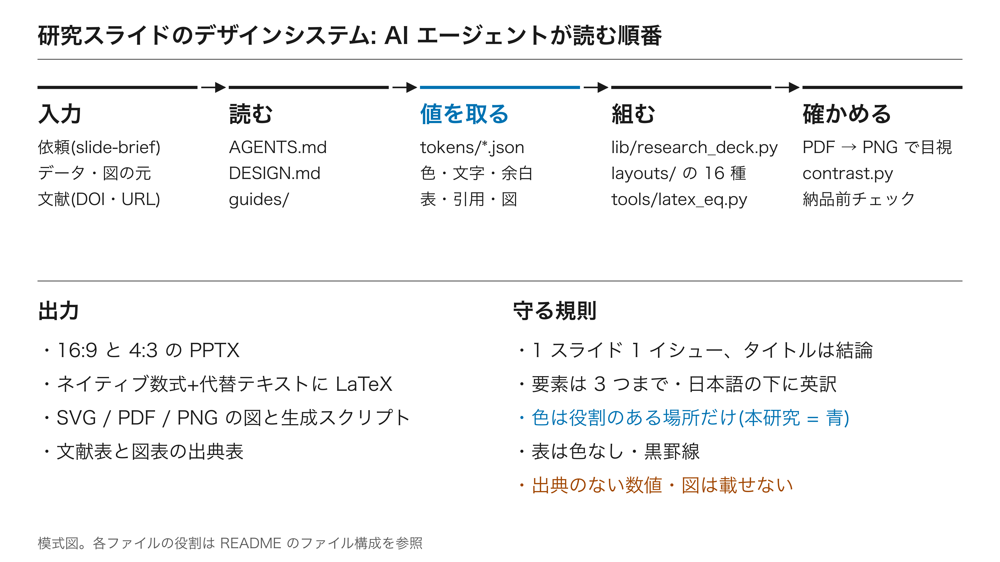
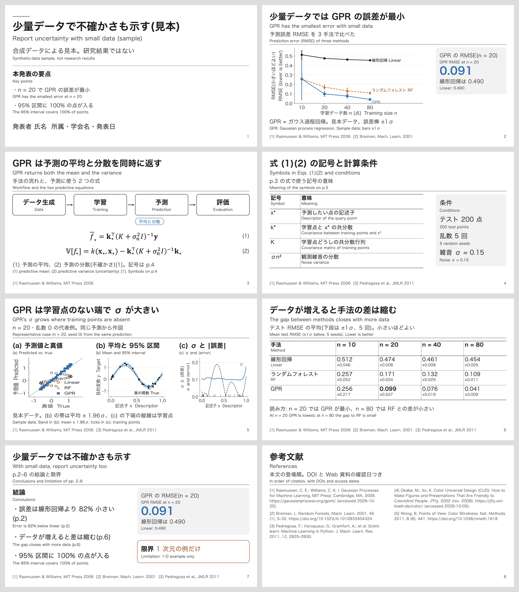
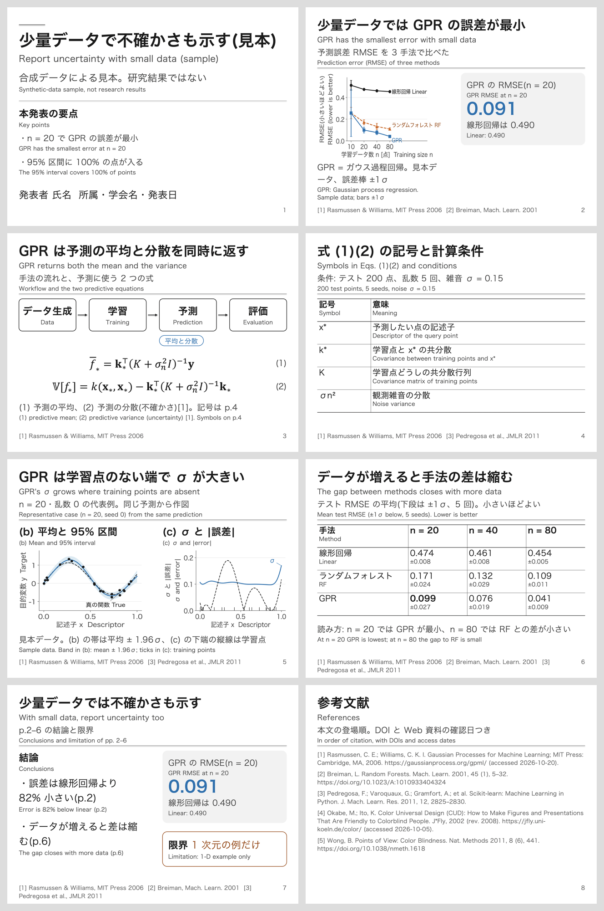
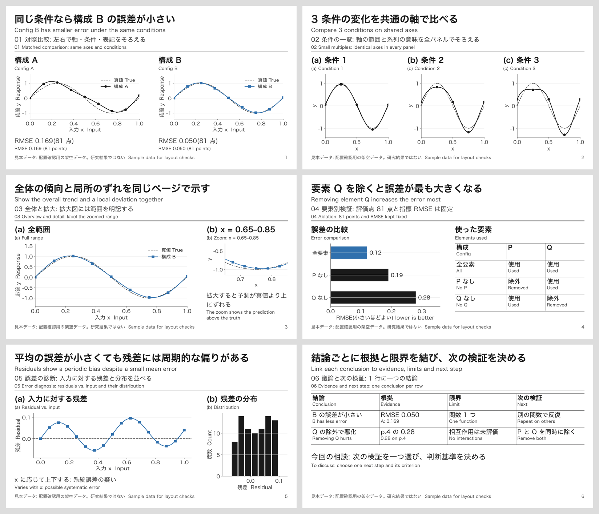

# research-slide-design

学会発表・研究紹介・進捗報告のための、**白黒基調・大きな文字・日英併記**のスライド用デザインシステム。
Claude Code / Codex などの AI エージェントがそのまま読める形(DESIGN.md + tokens + layouts + guides + lib + examples)にしてあり、仕様を読ませるだけで同じ見た目のスライドを作れる。



## 特徴

- **大きくはっきり・1 スライド 1 イシュー**: 本文 24pt、表とラベル 20pt。1 枚に置く要素は 3 つまでで、余白は残してよい。入らなければページを分ける。
- **日本語の下に英語訳**: 日本語の約 6 割の大きさ・灰色。英語訳を入れても崩れないよう、ビルダーが文字の高さを見積もり、はみ出し・本文下端超え・英語訳の長すぎを警告する。
- **第三者にわかる**: 略語は初出で説明、軸に名前・単位・向き、数値に比べる相手、結論に根拠のページ。
- **16:9(6 カラム)と 4:3(4 カラム)の両方**で、同じ原稿から組める。列の間は本文の 2 倍。
- **バリアフリーな色**: 白黒+役割を決めた色だけ(本研究 = Blue、注意 = 暗い Vermillion)。文字は 4.5:1 以上、主要な文字は 7:1 以上。色だけで区別しない。`tools/contrast.py` で検査。
- **表は色なし・黒罫線**、最大 5 行 × 5 列。**角丸は注・要点数値の面と枠だけ**(影なし)。
- **数式は LaTeX が正本**: PowerPoint のネイティブ数式に変換し、元の LaTeX を代替テキストに残す。
- **出典を必ず書く**: 本文 [n]、ページ下端の短い出典、最終ページの文献表(ACS 風)。
- 文字・余白・表・角丸の規定は、デジタル庁デザインシステムを参考にスライド用に読み替えた(色は採用していない)。

## 見本

`examples/build_sample.py` が架空の合成データから作る 8 枚。同じ原稿から 16:9 と 4:3 を作る。数値はすべてスクリプトの計算結果。

16:9



4:3



PDF: [16:9](examples/out/sample_16x9.pdf) / [4:3](examples/out/sample_4x3.pdf)

### 派生レイアウト 6 種

比較・検証・考察に使う構成。基本 10 種との選び分けは [ガイド](guides/layout-selection.md)。16:9 と 4:3 の両方で作る。



[PDF 16:9](examples/out/layout_gallery/layout_gallery_16x9.pdf) / [PowerPoint 16:9](examples/out/layout_gallery/layout_gallery_16x9.pptx) / [PowerPoint 4:3](examples/out/layout_gallery/layout_gallery_4x3.pptx) / [生成スクリプト](examples/build_layout_gallery.py)

数値はすべて見本データ。対照比較・残差図は合成関数から計算し、要素別検証の値は配置確認用に設定した定数。研究結果ではない。

## ファイル構成

```
research-slide-design/
├── README.md                  このファイル
├── AGENTS.md / CLAUDE.md      AI エージェントの入口(作業の順番と守ること)
├── DESIGN.md                  仕様の本体(版面・文字・色・図・表・数式・引用・納品前チェック)
├── REFERENCES.md              設計の根拠となった文献(DADS、Okabe & Ito、WCAG など)
├── CHANGELOG.md / LICENSE
├── tokens/                    値の正本(JSON)
│   ├── colors.json            色と役割(roles)、系列色・マーカー・線種
│   ├── typography.json        書体(PowerPoint 用のウェイト名)、文字サイズ、英語訳、字間
│   ├── spacing-16x9.json      16:9 の版面・6 カラム・余白 3 段階(標準)
│   ├── spacing.json           4:3 の版面・4 カラム
│   ├── shapes.json            角丸の段階と使う場所
│   ├── tables.json            色なし・黒罫線の表(最大 5 × 5)
│   ├── charts.json            グラフの様式
│   └── citation.json          引用・出典欄・文献表の書式(ACS 風)
├── layouts/                   16 種のページ構成(16:9 と 4:3 の両方)+比率ごとの組み分け
│   ├── cover.md  figure-notes.md  two-figures.md  figure-table.md  comparison-table.md
│   ├── method.md  equation.md  key-numbers.md  summary.md  references.md
│   ├── matched-comparison.md  small-multiples.md  overview-detail.md
│   ├── ablation.md  error-diagnosis.md  evidence-next.md
│   └── ratios.md
├── guides/                    使い方の手引き
│   ├── layout-selection.md    基本 10 種と派生 6 種の選び分け
│   ├── use-cases.md           学会発表・研究紹介・進捗報告の組み方、ユーザビリティ
│   ├── figures.md             図の作成フロー(模式図 SVG / matplotlib)
│   ├── equations.md           LaTeX の書き方・変換・取り出し
│   └── slide-brief.md         AI エージェントへの依頼書式(YAML)
├── lib/
│   ├── research_deck.py       python-pptx のビルダー(日英併記・角丸・高さの見積もりと警告)
│   └── research.mplstyle      matplotlib の様式
├── tools/
│   ├── latex_eq.py            LaTeX → PowerPoint ネイティブ数式(--convert / --extract)
│   └── contrast.py            色のコントラスト比の検査(WCAG 2.x)
├── examples/
│   ├── build_layout_gallery.py  派生レイアウト 6 種の見本(16:9 と 4:3)
│   ├── build_sample.py        見本デッキ(8 枚、16:9 と 4:3)を作る
│   ├── overview_figure.py     模式図(SVG)の見本。docs/ の図を作る
│   └── out/                   sample_16x9 / sample_4x3 の .pptx / .pdf
├── docs/                      README の図(overview / figure-flow)と見本の画像
├── skills/research-slide-design/  Claude Code / Codex 用スキル
└── scripts/
    ├── pptx2pdf.sh            PowerPoint で PDF に書き出す(macOS)
    ├── pdf2png.swift          PDF の全ページを PNG に(macOS)
    ├── export_svg.sh          SVG → PDF / PNG、最小文字サイズの検査(Inkscape)
    └── install_skill.sh       スキルを ~/.claude/skills と ~/.codex/skills にリンク
```

## 使い方

```bash
# 見本デッキを作る(依存は uv が一時的に用意する)
uv run --no-project --with python-pptx --with lxml --with latex2mathml \
  --with matplotlib --with numpy --with scikit-learn python examples/build_sample.py

# 派生レイアウト 6 種の見本を作る(16:9 と 4:3)
uv run --no-project --with python-pptx --with lxml --with matplotlib --with numpy \
  python examples/build_layout_gallery.py

# 見本を PDF 化する(macOS + PowerPoint)
scripts/pptx2pdf.sh examples/out/layout_gallery/layout_gallery_16x9.pptx examples/out/layout_gallery/layout_gallery_16x9.pdf

# PDF と PNG にして目視する(macOS + PowerPoint)
scripts/pptx2pdf.sh examples/out/sample_16x9.pptx examples/out/sample_16x9.pdf
swift scripts/pdf2png.swift examples/out/sample_16x9.pdf examples/out/png

# 色のコントラストを検査する
python3 tools/contrast.py

# 模式図を描いて書き出す(Inkscape)
python3 examples/overview_figure.py && scripts/export_svg.sh docs/overview.svg

# AI エージェント用スキルをリンクする
scripts/install_skill.sh
```

Python からは次のように組む(詳しくは `lib/research_deck.py` の冒頭と見本)。

```python
import sys; sys.path.insert(0, "lib")
from research_deck import Deck
deck = Deck("16:9")
s = deck.slide(("少量データでは GPR の誤差が最小", "GPR has the smallest error with small data"),
               ("予測誤差 RMSE を 3 手法で比べた", "Prediction error (RMSE) of three methods"))
x, w = s.col(0, 4)                       # 6 カラム(4:3 は 4 カラム)のうち 0 番から 4 本
s.image("fig.png", x, s.top, w, 3.8, credit=("本研究(未発表)", "This work (unpublished)"))
x, w = s.col(4, 2)
s.number_box(x, s.top, w, ("GPR の RMSE", "GPR RMSE"), "0.091", ("線形回帰は 0.490", "Linear: 0.490"), accent=True)
s.sources(["[1] Rasmussen & Williams, MIT Press 2006"])
deck.save("deck.pptx", strict=True)      # はみ出し・本文下端超え・英語訳の長すぎがあれば止める
```

### AI エージェントに使わせる

1. このリポジトリを作業フォルダに置くか、`scripts/install_skill.sh` でスキルをリンクする。
2. 「研究スライドのデザインで、このデータから 12 分の学会発表スライドを作って」のように頼む。エージェントは `AGENTS.md` → `DESIGN.md` → `guides/slide-brief.md` の書式で中身を整理し、足りない出典・数値を質問してから作る。
3. 仕上げに PDF → PNG で全ページを目視し、`DESIGN.md` の「納品前チェック」を満たしたものを渡す。

必要なもの: Python 3.10+(python-pptx, lxml, latex2mathml, matplotlib)、[uv](https://docs.astral.sh/uv/)(任意)、Microsoft PowerPoint(PDF 化と目視)、Microsoft Word(数式のネイティブ変換。ない場合は LaTeX のプレースホルダーになる)、Inkscape(SVG の書き出し)。フォントはヒラギノ角ゴ ProN(macOS 標準)。Windows では游ゴシックなどに置き換わるので、配布は PDF で行う。

## 参考文献

設計の根拠(詳細と確認日は [REFERENCES.md](REFERENCES.md))。

1. デジタル庁. デジタル庁デザインシステム: カラー. https://design.digital.go.jp/dads/foundations/color/ (accessed 2026-10-05).
2. デジタル庁. デジタル庁デザインシステム: カラー/アクセシビリティ. https://design.digital.go.jp/dads/foundations/color/accessibility/ (accessed 2026-10-05).
3. Okabe, M.; Ito, K. Color Universal Design (CUD): How to Make Figures and Presentations That Are Friendly to Colorblind People. J*Fly, 2002 (rev. 2008). https://jfly.uni-koeln.de/color/ (accessed 2026-10-05).
4. Office 伝わる(高橋佑磨, 片山なつ). 伝わるデザイン: ユニバーサルデザイン. https://tsutawarudesign.com/universal1.html (accessed 2026-10-05).
5. Rougier, N. P.; Droettboom, M.; Bourne, P. E. Ten Simple Rules for Better Figures. PLoS Comput. Biol. 2014, 10 (9), e1003833. https://doi.org/10.1371/journal.pcbi.1003833
6. Tufte, E. R. The Visual Display of Quantitative Information, 2nd ed.; Graphics Press: Cheshire, CT, 2001.
7. デジタル庁. デジタル庁デザインシステム: タイポグラフィ. https://design.digital.go.jp/dads/foundations/typography/ (accessed 2026-10-05).
8. Wong, B. Points of View: Color Blindness. Nat. Methods 2011, 8 (6), 441. https://doi.org/10.1038/nmeth.1618
9. W3C. Web Content Accessibility Guidelines (WCAG) 2.1. https://www.w3.org/TR/WCAG21/ (accessed 2026-10-05).
10. 科学技術振興機構. SIST02 参照文献の書き方, 2007 年版. https://jipsti.jst.go.jp/sist/handbook/sist02_2007/main.htm (accessed 2026-10-05).
11. Banik, G. M.; Baysinger, G.; Kamat, P. V.; Pienta, N. J., Eds. The ACS Guide to Scholarly Communication; American Chemical Society: Washington, DC, 2020. https://doi.org/10.1021/acsguide
12–15. デジタル庁. デジタル庁デザインシステム: 余白 / レイアウト / 角の形状 / テーブル. https://design.digital.go.jp/dads/ (確認 2026-11-04).

見本デッキの文献(Rasmussen & Williams 2006、Breiman 2001、Pedregosa et al. 2011)はスライドの最終ページに記載。

## ライセンス

MIT License(`LICENSE`)。見本の数値はすべて合成データで、研究結果ではない。
