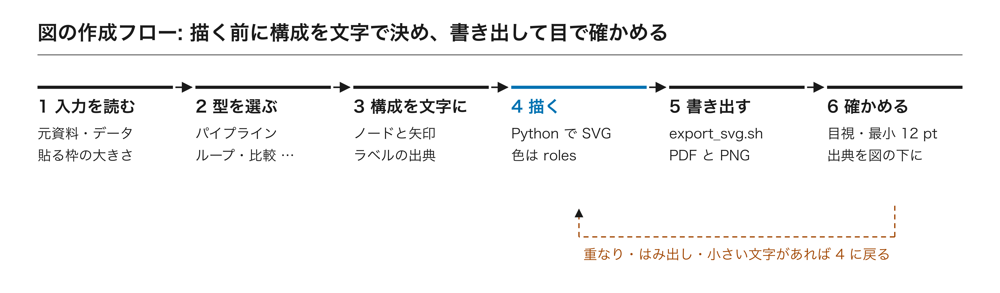

# 図の作り方(模式図・概要図・グラフ)

図は「描き始める前に構成を文字で決め、図形で描いて、書き出して目で確かめる」流れで作る。生成 AI の画像ではなく図形・データで描くので、ラベル・数値・矢印が正確に保たれ、後から直せる。

## 模式図・概要図・手法の流れ図(SVG)

1. **入力を読む。** 元資料(論文・要旨・データ)を先に読み、資料にない主張・数値・効果は描かない。用途(学会発表・研究紹介・論文)と貼り付け先の枠の大きさ(in)を決める。
2. **型を選ぶ。** 下の表から 1 つ。2 つ組み合わせるときは主の型を決める。

   | 型 | 使いどころ |
   | --- | --- |
   | パイプライン(左→右) | 手法の流れ、データ処理の順番 |
   | ループ | 最適化・実験計画・能動学習の繰り返し |
   | データ統合(複数→1) | 実験・計算・文献のデータを 1 つのモデルへ |
   | 比較(左右・上下) | 従来法と提案法、条件 A と B |
   | 階層・スケール | 原子 → 組織 → 部材、分子 → 細胞 → 個体 |
   | 概念+結果 | 上段に仕組み、下段に結果の要点 |

3. **構成を文字にする。** パネル(列)と流れを「ノード」と「矢印」の短いリストに書き、各ラベルの出典(ページ・節・図表番号)をメモする。
4. **描く。** Python(標準ライブラリだけでよい)で SVG を書く。座標は viewBox の単位で手書きし、16:9 の全面図は 1600 × 900、半面図は 800 × 900 を目安にする。見本は `examples/overview_figure.py`。
   - 色は `tokens/colors.json` の roles に従う(本研究 = accent、注意 = alert、他は白黒)。
   - 文字はアウトライン化せず `<text>` のまま残す(後で直せる)。`xml:space="preserve"` を付ける。
   - 色は `#rrggbb` の 6 桁。透明度は `fill-opacity` で付ける(8 桁の色は Inkscape で黒になる)。
   - 装飾カード・番号サークル・影・グラデーションは使わない。区切りは細い線と余白で。
   - 分数は分子・横線・分母に組む(見本 `SVG.frac()`)。`a/b` と書かない。
   - 実物に見える模式図には「模式図」と書く。
5. **書き出して目視する。** `scripts/export_svg.sh fig.svg` で PDF と PNG を作り、PNG を開いて重なり・はみ出し・切れたラベルがなくなるまで直す。
6. **文字の大きさを検査する。** スライドに貼った実寸で 12pt 以上か確かめる(`export_svg.sh` が最小文字を報告する)。
7. **保存する。** SVG・PDF・PNG と生成スクリプトを同じフォルダに置く。図の直下に出典(`本研究` / `Adapted from [n]` など)を書く。

## データのグラフ(matplotlib)

1. `from research_deck import use_chart_style` → `use_chart_style()` で `lib/research.mplstyle` を当てる。
2. **貼り付け先の枠の実寸で描く**(`figsize=(w, h)`、単位 in)。縮小・拡大で文字の大きさを変えない。
3. 本研究の系列 = Blue、比較手法 = 黒と系列 3–5。マーカーと線種を併用し、凡例より直接ラベル。
4. 軸ラベルに単位 [ ]。分数は mathtext の `$\frac{1000}{T}$` で横線に組む。パリティ図は y = x の破線を入れ、縦横の範囲をそろえる。
5. 数値はデータから計算する。誤差棒・区間は何の幅かを図の注に書く。
6. SVG/PDF(ベクター)を優先し、PNG は 300 dpi 以上。

## 他人の図を使うとき

ライセンス(CC BY など)と出版社の転載条件を確認し、図の直下に `Reproduced from [n]`(そのまま)/ `Adapted from [n]`(描き直し)と書く。確認できない図は自分で描き直し、元の図を出典として挙げる。
